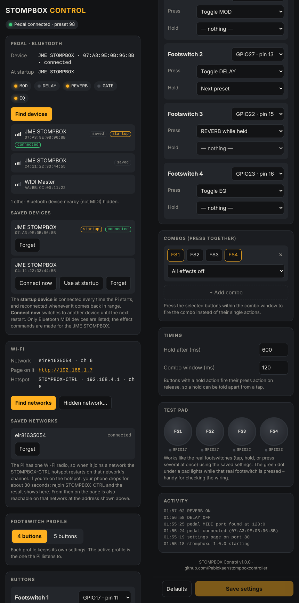
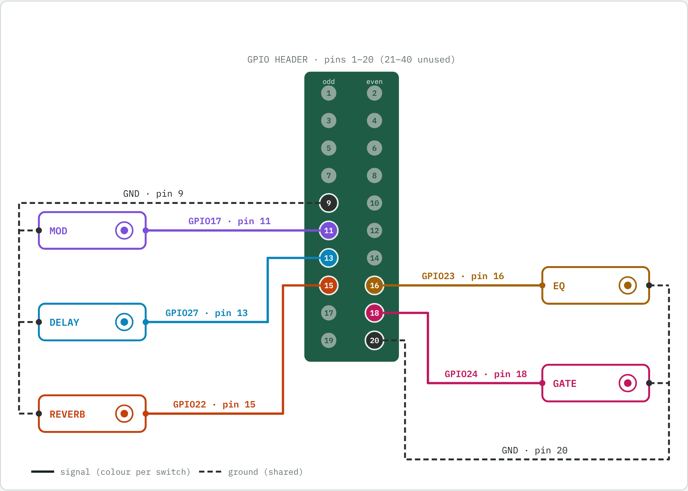
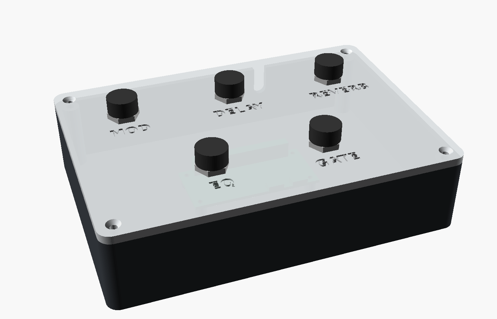
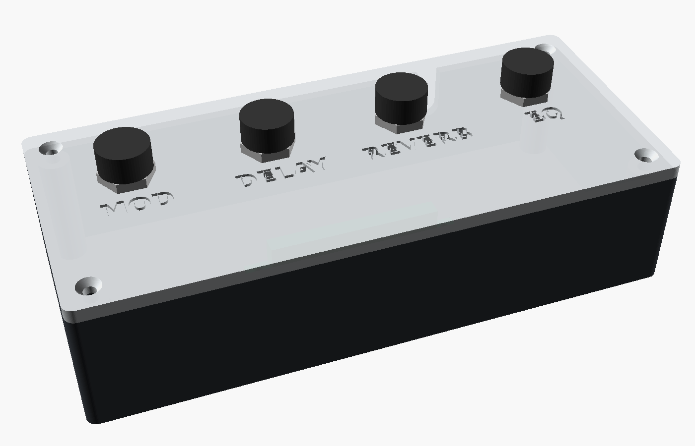
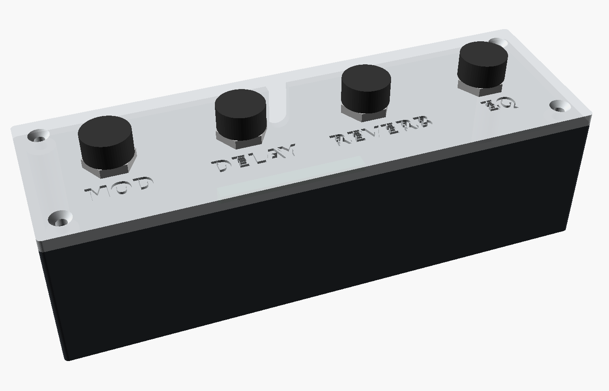

# STOMPBOX Controller

Wireless footswitch controller for the **JME STOMPBOX** guitar pedal, built on a
**Raspberry Pi Zero W**.

Footswitches wired to the Pi turn effects on and off on the pedal over
Bluetooth MIDI. The Pi broadcasts its own Wi-Fi network with a settings page
where you choose what each footswitch does (tap, hold, or several pressed
together), which Bluetooth device it connects to, and which Wi-Fi networks it joins.



_The settings page on a phone (example data – a second pedal and a WIDI adapter illustrate the device list)._

> **Two hardware options.** This README covers the **Raspberry Pi Zero W**
> version (tested on hardware). An **ESP32-C3** version with the same features
> and the same settings page lives in [`esp32-c3/`](esp32-c3) – cheaper, starts in
> seconds, installed from a browser; compiled but not yet tested on hardware.
> See [esp32-c3/README.md](esp32-c3/README.md).

> **Current version: 1.2.0** – see [CHANGELOG.md](CHANGELOG.md). This README is
> updated with every change to the project (see [Keeping this README current](#keeping-this-readme-current)).

---

## Contents

1. [What it does](#what-it-does)
2. [What you need](#what-you-need)
3. [Wiring the footswitches](#wiring-the-footswitches)
4. [3D-printed case](#3d-printed-case)
5. [Installing on a new Raspberry Pi](#installing-on-a-new-raspberry-pi)
6. [First start](#first-start)
7. [The settings page](#the-settings-page)
8. [How button actions work](#how-button-actions-work)
9. [Bluetooth devices](#bluetooth-devices)
10. [Wi-Fi and the hotspot](#wi-fi-and-the-hotspot)
11. [Command line: `stomp`](#command-line-stomp)
12. [MIDI map](#midi-map)
13. [Updating and uninstalling](#updating-and-uninstalling)
14. [Files and services on the Pi](#files-and-services-on-the-pi)
15. [Troubleshooting](#troubleshooting)
16. [Project structure and development](#project-structure-and-development)
17. [Keeping this README current](#keeping-this-readme-current)

---

## What it does

- **Connects to the pedal by itself.** On first start the Pi finds the JME
  STOMPBOX over Bluetooth, pairs with its MIDI side and saves it as the
  **startup device**. It connects to it at every start and reconnects whenever
  the pedal is switched on again. Devices are identified by their hardware
  address, so another pedal with the same name nearby is ignored.
- **Choose the Bluetooth device** from the settings page, like choosing a Wi-Fi
  network: search for nearby Bluetooth MIDI devices, **connect now** to one, or
  make it the device that is **always connected at startup**. Saved devices can
  be switched between or forgotten.
- **4 or 5 footswitches** on the Pi's GPIO pins, each with:
  - a **press** action and a **hold** action;
  - **combos**: two or more footswitches pressed together do something else.
- **Actions:** toggle an effect (MOD, DELAY, REVERB, GATE, EQ), effect on only
  while held, turn an effect on / off, all effects on / off, next / previous
  preset, go to a specific preset.
- **Own Wi-Fi network** (`STOMPBOX-CTRL`). Joining it opens the settings page
  automatically (captive portal), like hotel Wi-Fi.
- **Joins other Wi-Fi networks** from the settings page; the page is then also
  reachable on that network at the Pi's IP address.
- **Keeps the pedal's effect types:** switching an effect off and on never
  changes which effect is loaded in that slot.
- **Safe at start-up:** a footswitch that already reads "pressed" when the Pi
  starts (bad wiring, stuck pin) is ignored until it's released.

## What you need

| Item | Notes |
|---|---|
| Raspberry Pi Zero W (or Zero 2 W) | Built and tested on a **Zero W Rev 1.1**. Needs a soldered 40-pin header. |
| microSD card | 8 GB or more |
| 5 V power supply | Micro-USB into the **PWR IN** port, at least 1 A. A PC USB port can be too weak with Wi-Fi + Bluetooth on. |
| JME STOMPBOX pedal | Bluetooth MIDI |
| 4 or 5 momentary footswitches | SPST, **normally open, soft-touch** (non-latching), 12 mm mounting thread – the common guitar-pedal type |
| Hook-up wire | One signal wire per switch + a shared ground |
| Optional: 3D-printed case | See [3D-printed case](#3d-printed-case) |

## Wiring the footswitches

Each footswitch has two wires: one to its **GPIO pin**, one to **ground (GND)**.
No resistors are needed – the Pi's internal pull-ups are used. All ground pins
are the same, so one shared ground wire for all switches works too.



| Footswitch | Default effect | GPIO | Physical pin | Ground pin |
|---|---|---|---|---|
| FS1 | MOD | GPIO17 | 11 | 9 |
| FS2 | DELAY | GPIO27 | 13 | 9 |
| FS3 | REVERB | GPIO22 | 15 | 9 |
| FS4 | EQ | GPIO23 | 16 | 20 |
| FS5 (5-button profile only) | GATE | GPIO24 | 18 | 20 |

- **Pin 1** has the square solder pad, at the end of the header next to the SD-card slot.
  Odd pins are on the inner row, even pins on the board edge.
- Any ground pin works: 6, 9, 14, 20, 25, 30, 34, 39.
- **Never** connect a switch to 3.3 V (pins 1, 17) or 5 V (pins 2, 4).
- The pins can be changed per footswitch on the settings page (allowed: GPIO 4, 5, 6, 12, 13, 16, 17, 19, 20, 21, 22, 23, 24, 25, 26, 27).
- With the 4-button profile, only FS1–FS4 are used.

The diagram is also in [`hardware/wiring/wiring.html`](hardware/wiring/wiring.html) (open it in a browser).

## 3D-printed case

All parts are in [`hardware/case/`](hardware/case). Each variant has a base, a
lid with engraved labels, a lid without labels, the editable OpenSCAD source
and a preview image. Every variant fits within 170 mm in length.

| Variant | Size (L × W × H) | Buttons | Preview |
|---|---|---|---|
| [`5-buttons`](hardware/case/5-buttons) | 170 × 120 × 41 mm | MOD, DELAY, REVERB (back row) · EQ, GATE (front row, staggered) |  |
| [`4-buttons`](hardware/case/4-buttons) | 170 × 75 × 41 mm | MOD, DELAY, REVERB, EQ in one row toward the back; Pi beside them |  |
| [`4-buttons-slim`](hardware/case/4-buttons-slim) | 170 × 55 × 48 mm | MOD, DELAY, REVERB, EQ centred on the lid, 40 mm apart; Pi lies underneath |  |

Files in each folder:

| File | What it is |
|---|---|
| `base.stl` | Bottom part: Pi standoffs, floor vents, cable notch for the power cable, rubber-foot recesses |
| `lid.stl` | Top plate with switch holes and engraved labels |
| `lid_no_labels.stl` | Same lid, holes only |
| `case.scad` | OpenSCAD source – all dimensions are parameters at the top |
| `preview.png` | Assembled preview |

**Design details (all variants)**

- Switch holes **12.4 mm** for 12 mm (M12) soft-touch footswitches. *Print one
  lid first and check your switch fits* – change `sw_hole` in `case.scad` if not.
- 4 mm lid with stiffening ribs underneath and an alignment lip; 3 mm walls and floor.
- Lid fixed with **4 × M3 countersunk screws** (8–10 mm) into **M3 heat-set inserts**
  in the corner bosses. Without inserts, set `insert_d = 2.5` and use self-tapping screws.
- Pi fixed with **4 × M2.5 screws** (~6 mm) on 4–5 mm standoffs.
- Notch in the back wall for the micro-USB power cable (plug it in inside; the lid closes the notch).
- Recesses for 4 rubber feet up to 12 mm across.

**Printing:** PETG or ABS if possible (PLA works but softens in a hot car). Lid
with the top face down, 4 walls, ~40 % infill (it takes the stomping). Base
printed upright. No supports needed.

**Slim case note:** turn each switch so its solder tabs point along the length
of the box, so the tabs and wires stay clear of the Pi's pin header.

**Regenerating the STL files** after editing a `.scad` file (OpenSCAD 2021 or newer):

```bash
cd hardware/case/4-buttons-slim
openscad -D 'part="base"' -o base.stl case.scad
openscad -D 'part="lid"' -D 'show_labels=true'  -o lid.stl case.scad
openscad -D 'part="lid"' -D 'show_labels=false' -o lid_no_labels.stl case.scad
```

## Installing on a new Raspberry Pi

**Supported system:** Raspberry Pi OS **Lite (32-bit)** based on **Debian 13 "Trixie"**.
The Pi Zero W can only run 32-bit. Older "Bookworm" images do **not** work
(their ALSA tools lack `aseqsend`, which the installer checks for).

### Step 1 – Write the SD card

1. Open [Raspberry Pi Imager](https://www.raspberrypi.com/software/).
2. Device: *Raspberry Pi Zero*. OS: *Raspberry Pi OS (other)* → **Raspberry Pi OS Lite (32-bit)**.
3. In the customisation settings:
   - set a **hostname** (e.g. `stompbox`), **username and password** – don't keep `raspberry`;
   - enter your **Wi-Fi** network (needed to download the software; the Pi's own
     hotspot works without it later);
   - set your **Wi-Fi country** and time zone;
   - turn on **SSH** (password authentication).
4. Write the card.

### Step 2 – Install (choose one)

**Option A – one command over SSH (recommended, tested)**

Put the card in the Pi, power it on, wait ~3 minutes, then from a computer on the same network:

```bash
ssh <your-user>@<hostname>.local
curl -fsSL https://raw.githubusercontent.com/Pablokaer/stompboxcontroller/main/install.sh | sudo bash
```

**Option B – fully automatic on first boot (no SSH)**

Current Raspberry Pi OS images written with Raspberry Pi Imager are set up on
first boot by *cloud-init*. If the card's boot partition (the one you can open
on your computer after writing) contains a file called **`user-data`**, add this
at the end of it:

```yaml
runcmd:
  - [ bash, -c, "curl -fsSL https://raw.githubusercontent.com/Pablokaer/stompboxcontroller/main/install.sh | bash > /var/log/stompbox-install.log 2>&1" ]
```

If the file already has a `runcmd:` section, add only the `- [ bash, ... ]` line
under it (same indentation). The Pi then installs everything by itself on its
first start (~10–15 minutes on a Zero W). Progress: `/var/log/stompbox-install.log`.
*This option has not been tested on hardware yet – if it doesn't run, use Option A.*

> The one-line install downloads from GitHub, so the repository must be
> **public** (or use Option C).

**Option C – from a copy of the repository**

```bash
git clone https://github.com/Pablokaer/stompboxcontroller.git
cd stompboxcontroller
sudo ./install.sh
```

### Step 3 – Switch the pedal on

That's it. Within a minute the Pi finds the JME STOMPBOX and connects. The
hotspot `STOMPBOX-CTRL` appears and the settings page is ready.

### Installer options

Set these before the command (first install, or any later run to change them):

```bash
curl -fsSL https://raw.githubusercontent.com/Pablokaer/stompboxcontroller/main/install.sh \
  | sudo STOMPBOX_SSID=MY-PEDAL STOMPBOX_PASSWORD=mysecret1 STOMPBOX_COUNTRY=IE bash
```

| Variable | Default | Meaning |
|---|---|---|
| `STOMPBOX_SSID` | `STOMPBOX-CTRL` | Hotspot name (1–32 characters) |
| `STOMPBOX_PASSWORD` | `stompbox123` | Hotspot password (8–63 characters; empty = open network) |
| `STOMPBOX_COUNTRY` | system setting, else `IE` | Wi-Fi country code (legal channels / power) |
| `STOMPBOX_BRANCH` | `main` | Git branch to install |
| `STOMPBOX_REPO` | this repository | Git URL to install from |

### What the installer does

1. Installs the needed packages if missing: `python3 python3-lgpio bluez alsa-utils network-manager iw hostapd dnsmasq-base nftables git curl`.
2. Masks the stock `hostapd` service (the hotspot runs from its own service).
3. Migrates older hand-made setups (keeps the paired pedal, removes the old services).
4. Copies the program to `/opt/stompbox`, commands to `/usr/local/bin`, settings to `/etc/stompbox`.
5. Writes the hotspot settings and starts the `stompbox-ctrl` and `stompbox-ap` services.

It is **safe to run again**: it only installs what's missing and **keeps your
settings** (buttons, pedal, hotspot, saved Wi-Fi networks). Takes 1–3 minutes
when the packages are already there, 5–10 minutes on a fresh Pi Zero W.

## First start

1. **Pedal:** switch the JME STOMPBOX on near the Pi. With no device saved yet,
   the Pi scans, finds a device named `JME STOMPBOX` that offers Bluetooth MIDI,
   connects and saves it as the startup device. If several are in range, it
   picks the strongest signal. Takes ~20–60 seconds. To use a different device,
   see [Bluetooth devices](#bluetooth-devices).
2. **Hotspot:** join **`STOMPBOX-CTRL`** (password **`stompbox123`**) from a
   phone or laptop. The settings page opens automatically, or shows a "Sign in
   to network" notification. If the phone asks whether to stay on a network
   without internet, choose to stay connected.
3. **Page address:** `http://192.168.4.1` on the hotspot, or `http://<pi-ip>` on
   any network the Pi is connected to. On the hotspot, any `http://` address (for
   example `http://stompbox`) also leads to the page.
4. Check everything from the Pi: `stomp status`.

The Pi takes about **2.5 minutes** to start (normal for a Zero W), so the
hotspot appears a little after power-on.

## The settings page

| Section | What it does |
|---|---|
| **Pedal · Bluetooth** | The device in use (name, address, connection state), the **startup device**, and which effects are on now. **Find devices** lists nearby Bluetooth MIDI devices: tap one for **Connect now** or **Connect + always at startup**. **Saved devices**: Connect now, Use at startup, Forget (tap twice). See [Bluetooth devices](#bluetooth-devices). |
| **Wi-Fi** | The network the Pi is on and the page's address there; hotspot status. **Find networks** lists nearby networks – tap one, enter the password, Connect. **Hidden network…** for networks that don't broadcast their name. **Saved networks**: reconnect or forget (tap twice). |
| **Footswitch profile** | **4 buttons** or **5 buttons**. Each profile keeps its own settings; the active one is used. |
| **Buttons** | Per footswitch: GPIO pin, **Press** action, **Hold** action. |
| **Combos** | Pick 2+ footswitches and the action they trigger when pressed together. |
| **Timing** | **Hold after** (default 600 ms) and **Combo window** (default 120 ms). |
| **Test pad** | On-screen footswitches that behave exactly like the real ones (tap, hold, press several at once). The dot under each pad lights while the **real** footswitch is pressed – handy to check wiring. |
| **Activity** | Recent events: actions sent, pedal connection, warnings. |
| **Save settings** | Button settings are only applied after **Save**. **Defaults** loads the default layout (press Save to keep it). Wi-Fi and pedal actions apply immediately. |

Default layout: tap toggles **MOD, DELAY, REVERB, EQ** (and **GATE** on FS5 in
the 5-button profile); no holds, no combos.

## How button actions work

| Action | Behaviour |
|---|---|
| Toggle *effect* | Switches the effect on if off, off if on |
| *Effect* while held | Effect on while the footswitch is held, off when released (press action only; a held button can't also have a hold action) |
| Turn *effect* on / off | Always on / always off |
| All effects off / on | All five effects |
| Next / previous preset | Program Change ±1 from the current preset (from 0 if the current preset isn't known yet – it becomes known once you change preset on the pedal) |
| Go to preset… | Program Change to a fixed number (0–127) |

**Timing rules**

- A footswitch **without** a hold action fires **immediately** when pressed (or
  after the combo window, if it is part of a combo).
- A footswitch **with** a hold action waits: released before *Hold after* → press
  action; still held at *Hold after* → hold action. So its tap fires on release.
- **Combos:** all footswitches of a combo must be pressed within the *Combo window*
  of each other. Their single actions are then skipped until they're released.
- Footswitches are debounced (20 ms) and polled every 5 ms.

## Bluetooth devices

The Pi keeps a list of **saved devices** and one **startup device**.

| Term | Meaning |
|---|---|
| **Startup device** | Connected automatically every time the Pi starts, and reconnected whenever it comes back in range (e.g. the pedal is switched off and on). |
| **Device in use** | The one the footswitches control right now. Normally the startup device. |
| **Saved devices** | Every device you've connected to. Switch between them without searching again. |

On the settings page (**Pedal · Bluetooth**):

1. **Find devices** searches for about 10 seconds and lists nearby **Bluetooth MIDI**
   devices (other Bluetooth devices – phones, speakers – are counted but hidden).
   The pedal's second, audio-only Bluetooth address is not a MIDI device, so it
   never appears.
2. Tap a device:
   - **Connect now** – switch to it right away. The startup device doesn't change,
     so after a restart the Pi goes back to the startup device.
   - **Connect + always at startup** – switch to it and make it the startup device.
3. **Saved devices**: **Connect now**, **Use at startup**, or **Forget** (tap twice).
   Forgetting the startup device makes the next saved device the startup device.
   Forgetting the last one makes the Pi search for a JME STOMPBOX again by itself.

Notes:

- Only one device is connected at a time.
- The effect commands (CC numbers) are the JME STOMPBOX's. Another Bluetooth MIDI
  device can be connected, but it only reacts if it uses the same messages.
- When you switch devices, the Pi forgets the effect on/off states it knew and
  assumes "all on" until the new device reports its state.
- If the startup device is off or out of range, the Pi keeps trying in the
  background (every few seconds at first, then every 20 seconds).

## Wi-Fi and the hotspot

- The Pi Zero W has **one Wi-Fi radio**. It stays connected to a normal network
  (`wlan0`) **and** runs the hotspot (`uap0`) at the same time, but both must use
  the **same channel**. The hotspot always follows the channel of the network the
  Pi is on; with no network in range it uses channel 6.
- **Switching networks** from the page restarts the hotspot on the new channel.
  If your phone is on the hotspot it drops for ~30 seconds – rejoin it and the
  page shows the result and the new address.
- If a connection fails (e.g. wrong password), the Pi goes back to the network it
  was on.
- **Safety net:** if starting the hotspot ever knocks the Pi off its network, the
  hotspot removes itself so the Pi stays reachable.
- **Captive portal:** on the hotspot every name resolves to the Pi and every
  `http://` request is redirected to the page, so phones open it automatically.
  `https://` addresses can't be redirected (browsers block that by design).
  Devices on the hotspot can't reach the network the Pi is connected to.
- **Change the hotspot name / password:** re-run the installer with
  `STOMPBOX_SSID` / `STOMPBOX_PASSWORD`, or edit `/etc/stompbox/hotspot.conf` and run
  `sudo systemctl restart stompbox-ap`.
- The page has **no login**: anyone on the hotspot (with its password) or on the
  same network as the Pi can change the settings.

## Command line: `stomp`

Run on the Pi. It talks to the running service, so it shares the pedal connection and state.

```bash
stomp status            # version, device in use, saved devices, MIDI port, effects, profile
stomp mod off           # mod | delay | reverb | gate | eq   +  on | off | toggle
stomp all on            # all effects on | off
stomp preset 12         # go to preset 12   (or: next | prev)
stomp cc 6 64           # raw Control Change: CC number, value (0-127)
```

## MIDI map

| Effect | CC (channel 1) | On | Off |
|---|---|---|---|
| MOD | 3 | 64 | 0 |
| DELAY | 4 | 64 | 0 |
| REVERB | 5 | 65 | 1 |
| GATE | 6 | 64 | 0 |
| EQ | 7 | 64 | 0 |

Presets are Program Change messages. Full details, how the values work and how
to map more parameters: [docs/MIDI-MAP.md](docs/MIDI-MAP.md).

## Updating and uninstalling

```bash
sudo stompbox-update                    # latest version from GitHub; keeps all settings
sudo STOMPBOX_BRANCH=dev stompbox-update  # another branch
sudo /opt/stompbox/uninstall.sh         # remove (keeps /etc/stompbox)
sudo /opt/stompbox/uninstall.sh --purge # remove including settings and pedal pairing
```

The installed version is in `/opt/stompbox/version` (and the Git commit in
`/opt/stompbox/commit`), and at the bottom of the settings page.

## Files and services on the Pi

| Path | What it is |
|---|---|
| `/opt/stompbox/stompboxd.py`, `/opt/stompbox/web/` | The controller program and the settings page |
| `/opt/stompbox-src/` | Git checkout used by the installer / updates |
| `/usr/local/bin/stomp` | Command-line control |
| `/usr/local/bin/stompbox-ap.sh` | Starts / stops the hotspot |
| `/usr/local/bin/stompbox-update` | Update command |
| `/etc/stompbox/config.json` | Button settings (written by the page) |
| `/etc/stompbox/pedal.json` | Saved Bluetooth devices and the startup device (`{"default": "<address>", "devices": [...]}`); delete it to make the Pi search for a JME STOMPBOX again |
| `/etc/stompbox/hotspot.conf` | Hotspot name, password, country |
| `/etc/stompbox/dnsmasq.conf`, `captive.nft` | Hotspot addresses/DNS and captive-portal rules |
| `/etc/NetworkManager/conf.d/stompbox-unmanaged-uap0.conf` | Keeps NetworkManager away from the hotspot interface |
| `stompbox-ctrl.service` | Pedal connection, footswitches, settings page (port 80) |
| `stompbox-ap.service` | Hotspot (hostapd + dnsmasq + nftables on `uap0`) |

Logs: `journalctl -u stompbox-ctrl -f` and `journalctl -u stompbox-ap`.

## Troubleshooting

| Problem | What to do |
|---|---|
| **Pedal never connects** | Make sure it's on and near the Pi. `stomp status` shows *searching* / *connecting*. Check `journalctl -u stompbox-ctrl -f`. If a different JME STOMPBOX was saved before, use **Find devices** on the page and choose **Connect + always at startup** on the right one, or forget the old one. |
| **"Find devices" doesn't show the pedal** | It must be switched on and close to the Pi. A pedal connected to another device (e.g. a phone app) may not advertise – disconnect it there first. Search again. |
| **Commands sent but nothing changes on the pedal** | The pedal doesn't confirm commands. Check `stomp status` shows a MIDI port. Try `stomp mod toggle` and watch the pedal's MOD light. |
| **A footswitch fires by itself / test-pad dot always lit** | That pin reads "pressed" with nothing pressed: something connects it to ground (wire, solder bridge, damaged pin). The controller ignores it at start-up, but fix the wiring or move that footswitch to another GPIO on the page. (On the prototype Pi, GPIO22 / pin 15 had this fault.) |
| **Hotspot doesn't appear** | `systemctl status stompbox-ap`, `journalctl -u stompbox-ap`. Wait for the full boot (~2.5 min). `sudo systemctl restart stompbox-ap`. |
| **Phone sees the hotspot but can't connect** | Forget the network on the phone and join again. Check the password in `/etc/stompbox/hotspot.conf`. |
| **Page doesn't open by itself** | Open `http://192.168.4.1`. Some phones only show a "Sign in to network" notification. |
| **Lost the Pi after switching networks** | It's now on the new network: find its address in the router, or join the hotspot and look at the Wi-Fi section. |
| **Pi hangs / SD-card errors** | Use a proper 5 V / 1 A+ supply on PWR IN, not a PC USB port. `vcgencmd get_throttled` should say `0x0`. |
| **SSH suddenly refuses connections** | Recent OpenSSH versions temporarily block an address after many failed or interrupted logins. Wait ~10 minutes, or restart the Pi. |
| **Installer says `aseqsend is missing`** | The image is too old: use Raspberry Pi OS based on Debian 13 "Trixie". |

## Project structure and development

```
stompboxcontroller/
├── install.sh              installer / updater (safe to re-run)
├── uninstall.sh
├── software/
│   ├── stompboxd.py        controller: pedal (Bluetooth), MIDI, GPIO engine, Wi-Fi, web server
│   ├── web/index.html      settings page (single file, no external resources) – shared with the ESP32-C3 firmware
│   ├── bin/                stomp, stompbox-ap.sh, stompbox-update
│   └── system/             systemd services, dnsmasq + nftables + NetworkManager config
├── hardware/
│   ├── case/               5-buttons, 4-buttons, 4-buttons-slim: STL + SCAD + preview
│   └── wiring/             wiring diagram (PNG + HTML)
├── esp32-c3/               ESP32-C3 version: firmware, flasher, wiring, own README
├── docs/                   MIDI map, images
├── tests/                  footswitch logic, settings validation, Bluetooth device list
├── CHANGELOG.md
└── AGENTS.md               rules for anyone (human or AI) changing the project
```

**How it works (stompboxd.py)**

- `Pedal` – keeps Bluetooth on; saved devices, startup device and device in use;
  searches, trusts and connects; finds a JME STOMPBOX by itself when nothing is saved.
- `Midi` – finds the pedal's ALSA port, sends with `aseqsend`, listens with
  `aseqdump` to track current effect values and preset.
- `Gpio` + `Engine` – polls the footswitch pins (lgpio, pull-ups, active low),
  debounces, and resolves press / hold / momentary / combos into actions.
- `Wifi` – scans and joins networks through NetworkManager (`nmcli`) and restarts
  the hotspot on the right channel.
- `Handler` – web server (port 80) for the page, the JSON API and the captive portal.

**HTTP API** (used by the page and `stomp`)

| Method | Path | Body / result |
|---|---|---|
| GET | `/api/status` | version, pedal, effects, preset, pin states, log |
| GET / POST | `/api/config` | button settings (POST validates, saves and applies) |
| GET | `/api/default` | default settings |
| POST | `/api/action` | an action, e.g. `{"type":"toggle","effect":"mod"}` |
| POST | `/api/cc` | `{"cc":6,"value":64}` raw Control Change |
| POST | `/api/sim` | `{"button":0,"down":true}` test-pad press/release |
| POST | `/api/bt/scan` | search ~10 s; nearby devices `{mac,name,rssi,midi,saved,startup,active,connected}` |
| POST | `/api/bt/connect` | `{"mac":"…","startup":true}` connect now (and optionally make it the startup device) |
| POST | `/api/bt/startup` | `{"mac":"…"}` make a saved device the startup device |
| POST | `/api/bt/forget` | `{"mac":"…"}` forget a saved device |
| POST | `/api/pedal/forget` | forget the device in use |
| GET | `/api/wifi` | current network, hotspot, saved networks, last operation |
| POST | `/api/wifi/scan` · `/connect` · `/up` · `/forget` | scan; join `{ssid,password,hidden}`; reconnect / forget `{name}` |

**Tests** (any computer with Python 3, no Pi needed):

```bash
python3 -m unittest discover -s tests -v
```

**Developing on a Pi:** edit, then `sudo ./install.sh` from your checkout to deploy.

## Keeping this README current

This README is part of every change. Any change to behaviour, files, settings,
hardware or installation must update the matching section here **and** add an
entry to [CHANGELOG.md](CHANGELOG.md) in the same commit, and bump `VERSION` in
`software/stompboxd.py` for releases. The full checklist is in [AGENTS.md](AGENTS.md).
