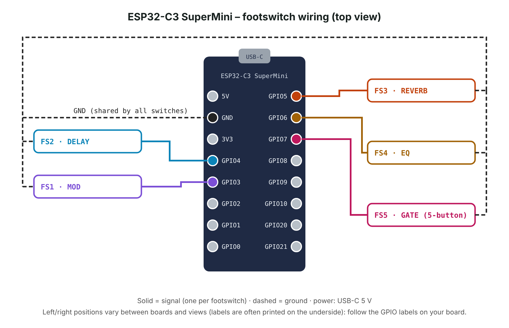

# STOMPBOX Controller – ESP32-C3 version

Everything specific to running the STOMPBOX Controller on an **ESP32-C3** board
instead of a Raspberry Pi. Same features, same settings page, same MIDI
commands – as firmware for a ~€4 board that starts in about 2 seconds.

> **Status: logic tested on a computer, not yet tested on a real board.** The
> firmware (version 1.3.1) builds cleanly, and its footswitch engine, settings
> validation and Bluetooth MIDI parser pass 16 unit tests – the same scenarios as
> the Raspberry Pi version, which is tested on hardware with the pedal. Until
> someone confirms it on a real ESP32-C3, treat it as a first test release – see
> [Testing checklist](#testing-checklist).

For the hardware shared with the Pi version (footswitches, MIDI map, how the
buttons behave), see the [main README](../README.md).

---

## Contents

1. [Raspberry Pi or ESP32-C3?](#raspberry-pi-or-esp32-c3)
2. [What you need](#what-you-need)
3. [Wiring](#wiring)
4. [Installing the firmware](#installing-the-firmware)
5. [First start](#first-start)
6. [Using it](#using-it)
7. [Updating](#updating)
8. [Factory reset](#factory-reset)
9. [Other ESP32-C3 boards](#other-esp32-c3-boards)
10. [Building from source](#building-from-source)
11. [How it works](#how-it-works)
12. [Troubleshooting](#troubleshooting)
13. [Testing checklist](#testing-checklist)
14. [Folder contents](#folder-contents)

---

## Raspberry Pi or ESP32-C3?

| | Raspberry Pi Zero W | ESP32-C3 |
|---|---|---|
| Hardware tested with the pedal | ✅ Yes | ❌ Not yet |
| Automated tests of the logic | ✅ 24 | ✅ 16 (same footswitch scenarios) |
| Start-up time | ~2.5 minutes | ~2 seconds |
| Price | ~€15–20 + SD card | ~€3–6 |
| Safe to unplug any time | SD card can get corrupted | ✅ Yes |
| Installing | One command over SSH | Flash once over USB (browser flasher) |
| Updates | `sudo stompbox-update` | Upload a file on the settings page (`/update`) |
| Settings page, hotspot, captive portal | ✅ | ✅ Same page |
| Joins other Wi-Fi networks | ✅ | ✅ |
| Rejoins any saved network in range | ✅ | ✅ (after 30 s without a connection) |
| Hotspot name / password from the settings page | ✅ | ✅ |
| Bluetooth device manager | ✅ | ✅ |
| Command line (`stomp`), SSH, logs | ✅ | ❌ (activity log on the page; USB serial console) |
| Phones with hard-coded DNS redirected to the page | ✅ | ❌ (they need `http://192.168.4.1`) |
| Devices on the hotspot at once | many | 4 (configurable up to 10) |

## What you need

| Item | Notes |
|---|---|
| **ESP32-C3 SuperMini** board | The firmware's default pins are for this board. Others work after changing `include/config.h` – see [Other boards](#other-esp32-c3-boards). |
| USB-C cable that carries **data** | Some cables are charge-only – the flasher won't see the board. |
| 5 V USB power | Phone charger, power bank or pedalboard USB port. |
| JME STOMPBOX pedal | |
| 4 or 5 momentary footswitches | Same as the Pi version: SPST, normally open, soft-touch, 12 mm |
| Hook-up wire | One signal wire per switch + a shared ground |

## Wiring



| Footswitch | Default effect | GPIO | Ground |
|---|---|---|---|
| FS1 | MOD | GPIO3 | any GND |
| FS2 | DELAY | GPIO4 | any GND |
| FS3 | REVERB | GPIO5 | any GND |
| FS4 | EQ | GPIO6 | any GND |
| FS5 (5-button profile) | GATE | GPIO7 | any GND |

- Each switch: one wire to its GPIO, one to **GND**. No resistors – the chip's internal pull-ups are used.
- The pins can be changed per footswitch on the settings page. Allowed: GPIO 0, 1, 3, 4, 5, 6, 7, 10, 20, 21.
- **Don't use GPIO 2, 8 or 9** for switches: they decide how the chip boots, so a
  pressed or mis-wired switch could stop it from starting. GPIO 8 is also the
  on-board LED, GPIO 9 the BOOT button.
- Never connect a switch to **5V** or **3V3**.
- **Follow the GPIO labels printed on your board, not the left/right positions in
  the drawing.** Published SuperMini pinouts disagree on which side is which (top
  and bottom views are mirror images, and the labels are often printed on the
  underside), so the drawing's sides may be swapped on your board. The GPIO
  numbers are what matter: the firmware only cares that FS1 is on the pin labelled
  3, FS2 on 4, and so on.

**On-board LED (GPIO 8):** on = pedal connected · blinking = searching / connecting.

## Installing the firmware

### Option A – browser flasher (easiest)

1. Open the flasher page in **Chrome or Edge on a computer**:
   **https://pablokaer.github.io/stompboxcontroller/esp32-c3/flasher/**
   *(works once GitHub Pages is switched on for the repository: Settings → Pages →
   Deploy from branch `main`, folder `/ (root)`).*
2. Plug the board in with a USB-C data cable.
3. Click **Install STOMPBOX firmware**, choose the board's port (often
   "USB JTAG/serial debug unit") and confirm. Takes about a minute.

If the board isn't found: hold the **BOOT** button while plugging the cable in, then try again.

### Option B – Espressif's web flasher (no GitHub Pages needed)

1. Open **https://espressif.github.io/esptool-js/** in Chrome or Edge.
2. Hold the board's **BOOT** button while plugging in the USB-C cable, then release it.
3. Click **Connect** and choose the board's port.
4. Set **Flash Address** to `0x0`, choose `release/stompbox-esp32c3-full.bin`, click **Program**.
5. When it's done, unplug and plug the board in again (without BOOT).

The same page's **Console** tab shows the board's start-up log – useful if something doesn't work.

### Option C – esptool (any computer with Python)

```bash
pip install esptool
esptool.py --chip esp32c3 write_flash 0x0 release/stompbox-esp32c3-full.bin
```

### Option D – PlatformIO (from source)

```bash
cd esp32-c3
pio run -t upload        # builds and flashes
pio device monitor       # serial console (115200 baud)
```

## First start

1. Power the board. A few seconds later the Wi-Fi **`STOMPBOX-CTRL`** appears
   (password **`stompbox123`**).
2. Switch the **JME STOMPBOX** on near the board. With nothing saved, the board
   finds it by itself, connects and saves it as the **startup device** (LED stops blinking).
3. Join `STOMPBOX-CTRL` with a phone: the settings page opens by itself
   (or open `http://192.168.4.1`).
4. Optional: in the **Wi-Fi** section, join your home network. The page is then
   also at the address shown there, or at **`http://stompbox.local`**.

## Using it

The settings page is the same as on the Raspberry Pi – see
[The settings page](../README.md#the-settings-page),
[How button actions work](../README.md#how-button-actions-work) and
[Bluetooth devices](../README.md#bluetooth-devices) in the main README.

Differences on the ESP32-C3:

- The footswitch pin list shows ESP32-C3 GPIO numbers.
- The page footer shows the version and `esp32c3`.
- The hotspot keeps running when the board joins another network; it moves to
  that network's channel (one radio, like the Pi Zero).
- The hotspot name and password can be changed on the settings page (Wi-Fi →
  Hotspot). The defaults (`STOMPBOX-CTRL` / `stompbox123`) come from `include/config.h`
  and return after a [factory reset](#factory-reset).
- Saved Wi-Fi networks: at start-up, and whenever the connection has been lost for
  30 seconds, the board joins the strongest saved network in range (retrying less
  often, up to every 5 minutes, while none is found).

## Updating

1. Download `release/stompbox-esp32c3-app.bin` from the repository.
2. Open **`http://192.168.4.1/update`** (or `http://stompbox.local/update`).
3. Choose the file and click **Upload and install**. The board restarts; all
   settings (buttons, devices, Wi-Fi networks) are kept.

The browser flasher also works for updates, but it erases the board's settings.

## Factory reset

Hold the board's **BOOT** button for **10 seconds** while it's running. Button
settings, saved Bluetooth devices and saved Wi-Fi networks are deleted and the
board restarts as new (it then looks for a JME STOMPBOX by itself).

## Other ESP32-C3 boards

All board-specific values are in [`include/config.h`](include/config.h):

| Setting | Default (SuperMini) | Change it when… |
|---|---|---|
| `DEFAULT_PINS` | `{3, 4, 5, 6, 7}` | your board doesn't expose these pins |
| `ALLOWED_PINS` | `{0, 1, 3, 4, 5, 6, 7, 10, 20, 21}` | your board has other free pins |
| `STATUS_LED_PIN` / `STATUS_LED_ACTIVE_LOW` | `8` / `1` | the LED is elsewhere (e.g. an RGB LED on DevKitM-1 is GPIO 8 but needs a different driver) |
| `BOOT_BUTTON_PIN` | `9` | almost never |
| `HOTSPOT_SSID` / `HOTSPOT_PASSWORD` | `STOMPBOX-CTRL` / `stompbox123` | you want other **defaults** (they can also be changed on the page) |

Then build and flash from source (Option D).

## Building from source

Requirements: [PlatformIO](https://platformio.org/) (VS Code extension or `pip install platformio`).

```bash
cd esp32-c3
pio run
```

- The build **embeds the shared settings page** (`../software/web/index.html`)
  into the firmware (`scripts/embed_web.py`), so the Pi and the ESP32-C3 always
  use the same page.
- After building, `scripts/merge_bin.py` writes both release files to `release/`:
  - `stompbox-esp32c3-full.bin` – everything, flash at address `0x0` (first install, browser flasher);
  - `stompbox-esp32c3-app.bin` – the app only, for updates over Wi-Fi.
- Pinned versions: Espressif32 platform 6.9.0 (Arduino core), NimBLE-Arduino 1.4.2, ArduinoJson 7.2.1.

**Tests on the computer** (no board needed):

```bash
cd esp32-c3
pio test -e native
```

They compile the real `settings.cpp` and `engine.cpp` with small Arduino
stand-ins (`test/stubs/`) and run 16 tests: the same footswitch scenarios as the
Raspberry Pi tests (tap, hold, on-while-held, combo, effect-type bits, real pin
press, stuck pin at start), settings validation, and the BLE-MIDI parser with
packets recorded from the JME STOMPBOX. Not covered: Bluetooth, Wi-Fi and the
web server – those need a real board (see the testing checklist).

## How it works

| File | What it does |
|---|---|
| `src/main.cpp` | Start-up, status LED, factory reset |
| `src/pedal.cpp` | Bluetooth LE MIDI client (NimBLE): saved devices, startup device, automatic JME STOMPBOX search, reconnecting, sending MIDI, current effect values |
| `src/blemidi.h` | BLE-MIDI packet parser (unit-tested) |
| `src/engine.cpp` | Footswitches: debounce, press / hold / momentary / combos – a port of the Pi's engine – and the actions |
| `src/net.cpp` | Hotspot + Wi-Fi client, hotspot settings, rejoining saved networks, DNS captive portal, mDNS, web server with the same JSON API as the Pi, Wi-Fi management, firmware update page |
| `src/settings.cpp` | Settings format and validation (same JSON as the Pi), log, file helpers |
| `include/config.h` | Board pins and defaults |

Settings are stored in the chip's flash (LittleFS): `/config.json`,
`/pedal.json`, `/wifi.json` – the same formats as on the Pi.

Tasks: the footswitch engine runs every 5 ms in its own task, the pedal
connection in another, and the web server / DNS in the main loop, so a
Bluetooth or Wi-Fi scan from the page never delays the footswitches.

## Troubleshooting

| Problem | What to do |
|---|---|
| **New board: USB keeps connecting and disconnecting** | Normal for a board with no firmware: the chip finds nothing to run and restarts about every second, which drops the USB connection. Hold **BOOT** while plugging in – the port then stays put – and flash the firmware. |
| **Keeps restarting after flashing** | Usually power: use a good cable and a USB port or charger that gives enough current. The firmware already lowers Wi-Fi power (`WIFI_TX_POWER` in `config.h`) because many SuperMini boards reset at full power; try `WIFI_POWER_5dBm` if it still happens. The Console of the web flasher shows the reason for each restart. |
| Flasher doesn't find the board | Use a data USB-C cable; hold **BOOT** while plugging in; use Chrome/Edge on a computer. |
| No `STOMPBOX-CTRL` network | Check the board has power (LED blinks while searching for the pedal). Open the serial console (`pio device monitor`) to see the start-up log. |
| Pedal never connects | Pedal on and close by; not connected to a phone app at the same time. Use **Find devices** on the page. |
| A footswitch fires by itself / its dot on the test pad stays lit | That pin reads "pressed": check wiring, or move it to another GPIO on the page. Never use GPIO 2, 8, 9. |
| Board won't start after wiring the switches | A switch on a boot pin (2, 8, 9) is pressed or shorted – move it. |
| Page doesn't open by itself | Open `http://192.168.4.1`. |
| Settings messed up | [Factory reset](#factory-reset). |

## Testing checklist

To confirm the ESP32-C3 version on real hardware (please report results so this
README can be updated):

- [ ] Browser flasher installs the firmware; `STOMPBOX-CTRL` appears within seconds.
- [ ] With the pedal on, it is found and connected automatically; LED steady.
- [ ] Test pad on the page switches effects on the pedal (MOD on/off).
- [ ] Real footswitches on GPIO 3–7 work: tap, hold, combo.
- [ ] Changing a preset on the pedal shows the new preset number on the page.
- [ ] Joining a home network from the page works; `http://stompbox.local` opens.
- [ ] Footswitch response while the hotspot is in use feels instant (Wi-Fi and Bluetooth share the radio).
- [ ] Changing the hotspot name/password on the page works; the new name appears.
- [ ] Switching the home router off and on: the board rejoins by itself.
- [ ] Firmware update via `/update` keeps settings.
- [ ] Factory reset (BOOT 10 s) works.

## Folder contents

```
esp32-c3/
├── README.md            this file
├── platformio.ini       build configuration (pinned versions)
├── include/config.h     board pins and defaults
├── src/                 firmware source
├── scripts/             embed the shared page, write release binaries
├── release/             ready-to-flash firmware (full + update)
├── flasher/             browser flasher page (ESP Web Tools) + manifest
├── test/                unit tests run on the computer (pio test -e native) + Arduino stand-ins
└── wiring/              SuperMini wiring diagram (SVG + PNG)
```

Keep this README current with every change to the ESP32-C3 version (see [AGENTS.md](../AGENTS.md)).
